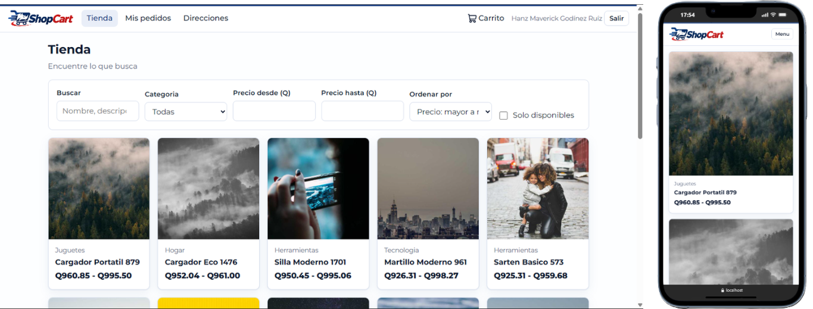
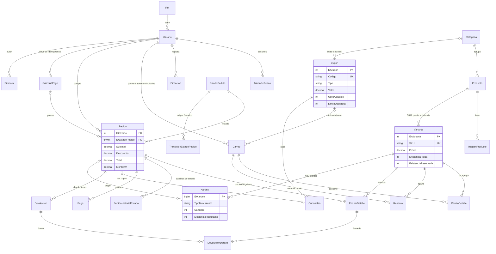
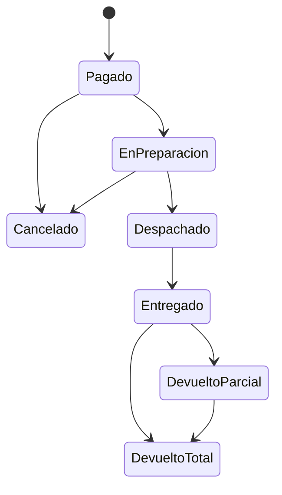

# ShopCart - Tienda en linea

Plataforma de ventas con **SQL Server** (todo el acceso a datos por stored procedures), **Node.js + Express + TypeScript** y **React + TypeScript**.
Documentacion complementaria: [`docs/ARQUITECTURA.md`](docs/ARQUITECTURA.md) (estructura y estado) · [`docs/API.md`](docs/API.md) (endpoints) · [`backend/README.md`](backend/README.md) · [`frontend/README.md`](frontend/README.md).

Screenshots:
### Página principal


Más disponibles en [`./screenshots/`](./screenshots/).

## 1. Puesta en marcha (maquina limpia)
Requisitos: SQL Server 2019+ (con `sqlcmd`), Node.js 24 LTS y pnpm 12 (`corepack enable` o `npm i -g pnpm`).

1. **Base de datos** (crea esquema, SPs y semilla grande; ejecutar siempre en orden numerico):
   ```bash
   cd database
   DB_SERVER=localhost DB_USER=sa DB_PASSWORD='***' ./run_all.sh --reset      # --reset recrea la BD; SKIP_SEED_GRANDE=1 omite la 016
   ```
   Sin Bash: correr con SSMS / Azure Data Studio `000_Reiniciar.sql` (opcional) y luego `001` ... `017` en orden.
2. **Backend:**
   ```bash
   cd backend
   cp .env.example .env          # completar DB_USER, DB_PASSWORD y JWT_ACCESS_SECRET (>= 32 caracteres)
   pnpm install --frozen-lockfile
   pnpm seed                     # usuarios demo, direccion y cupones de ejemplo
   pnpm dev                      # http://localhost:3000/api/health
   ```
3. **Frontend** (con el backend en marcha):
   ```bash
   cd frontend
   pnpm install --frozen-lockfile
   pnpm dev                      # http://localhost:5173 (el proxy de Vite envia /api al backend)
   pnpm test                     # pruebas del cliente HTTP
   ```
4. **Prueba de concurrencia** (API en marcha con `RATE_LIMIT_AUTH_POR_MINUTO=1000`): en `backend`, `pnpm concurrencia`.

### Credenciales de prueba
| Rol | Correo | Contrasena |
|---|---|---|
| Administrador | `admin@shopcart.test` | `Admin123!` |
| Operador | `operador@shopcart.test` | `Operador123!` |
| Cliente | `cliente@shopcart.test` | `Cliente123!` |
| Semilla grande (2 000 clientes + operador) | `clienteNNNN@seed.shopcart.test`, `operador.seed@shopcart.test` | `Seed123!` |

Cupones de ejemplo: `BIENVENIDO10` (10 %, minimo Q100) y `ROPA25` (Q25 en la categoria Ropa).

## 2. Arquitectura
```
React (SPA)  ->  Express: routes -> services -> repositories  ->  SQL Server: stored procedures (+ triggers/CHECK)
                    validacion zod · JWT/roles · errores centralizados        reglas criticas, transacciones, concurrencia, auditoria
```
- **Sin ORM ni SQL en el backend:** `backend/src/db/sp.ts` es la unica puerta a datos y solo ejecuta SPs con parametros tipados.
- **Concurrencia:** orden global de bloqueo (`Carrito -> Variantes por IDVariante ascendente -> Cupon`), reserva con `UPDATE` condicionado, `XACT_ABORT ON`, reintento ante interbloqueo (1205).
- **Idempotencia del pago:** `UNIQUE (IDUsuario, ClaveIdempotencia)` + hash de la solicitud.
- **Seguridad de datos de cliente:** el dueno sale del JWT (o del token de invitado); ningun endpoint acepta un id de carrito; un pedido ajeno responde 404.

## 3. Modelo entidad-relacion


## 4. Ciclo de vida del pedido

Las transiciones viven en la tabla `TransicionEstadoPedido` y se validan en el SP y en el trigger `TR_Pedido_ValidarTransicion`. Cancelar solo es posible antes de despachar; las devoluciones, solo desde `Entregado`/`DevueltoParcial`.

## 5. Decisiones abiertas y supuestos
| Tema | Decision |
|---|---|
| IVA | Precios publicados con IVA 12 % incluido; `MontoIVA = Total * 12 / 112`, redondeado a 2 decimales. |
| Dinero | `DECIMAL(18,2)` en BD; el backend no hace calculos monetarios. |
| Pedido nace "Pagado" | El pedido se crea atomicamente al aprobarse el pago; la pasarela esta simulada. |
| Reserva | 15 min al "iniciar pago"; todo el carrito o nada; modificar el carrito libera la reserva. Las vencidas se liberan por job (60 s) y perezosamente al reservar. |
| Precio congelado | El precio y el descuento se leen bajo bloqueo y se copian a `PedidoDetalle`. Si el total cambio desde que el cliente lo vio (`totalEsperado`), el pago se rechaza con 409. |
| Cupon: minimo | Se compara con el subtotal del carrito completo (IVA incluido, antes del descuento). Vigencia en UTC. Un cupon por pedido; el descuento se prorratea por linea y nunca supera la base elegible. |
| Cupon al cancelar | El uso se anula (`CuponUso.Anulado`) y se devuelve el cupo. |
| Devoluciones | Las registra el Operador/Administrador, por linea y parciales; reintegran existencia (kardex) y registran un reembolso. El reembolso de la ultima unidad completa exactamente el subtotal de la linea. |
| "Pedidos completados" en reportes | Cuentan los pedidos **no Cancelados ni DevueltoTotal**; las devoluciones parciales se descuentan del pedido original. Ticket promedio = ventas netas / pedidos. |
| Zona horaria | Almacenamiento en UTC; reportes agrupados en hora de Guatemala (UTC-6, sin horario de verano). Semana = lunes a domingo. |
| Carrito abandonado | Carrito activo con productos sin actividad durante N horas (parametro, 24 por defecto). |
| Sesiones | Access JWT 15 min + refresh opaco con rotacion y deteccion de reutilizacion; el refresh viaja en el cuerpo (mejora posible: cookie httpOnly + CSRF). El usuario se recarga en cada peticion, asi desactivar una cuenta surte efecto inmediato. |
| Interbloqueos | Se evitan por orden de bloqueo y, si ocurren (1205), el backend reintenta 3 veces. |

## 6. Cumplimiento de requisitos tecnicos
- **BD:** modelo normalizado con PK/FK/UNIQUE/NOT NULL/CHECK; `DECIMAL`, nunca `FLOAT`; scripts SQL numerados y reproducibles; solo SPs; nomenclatura `SP_Modulo_Proceso`, `VW_`, `FU_`, `IDTabla`.
- **Backend:** TypeScript strict, capas, validacion zod, errores centralizados, `.env.example`, sin credenciales en el repo, CORS y cabeceras de seguridad (helmet), rate limit en `/auth`.
- **Dependencias:** pnpm con versiones exactas, scripts de instalacion bloqueados y antiguedad minima de 7 dias (`pnpm-workspace.yaml`); auditoria documentada en `backend/README.md`.
- **Tiempo real (extra):** el dashboard, las listas y el detalle de pedidos se actualizan solos por SSE; el cliente ve el cambio de estado de su pedido sin recargar (ver `docs/ARQUITECTURA.md`, seccion 4b).
- **Inmutabilidad:** bitacora, kardex e historial de estados no admiten UPDATE/DELETE (triggers).
