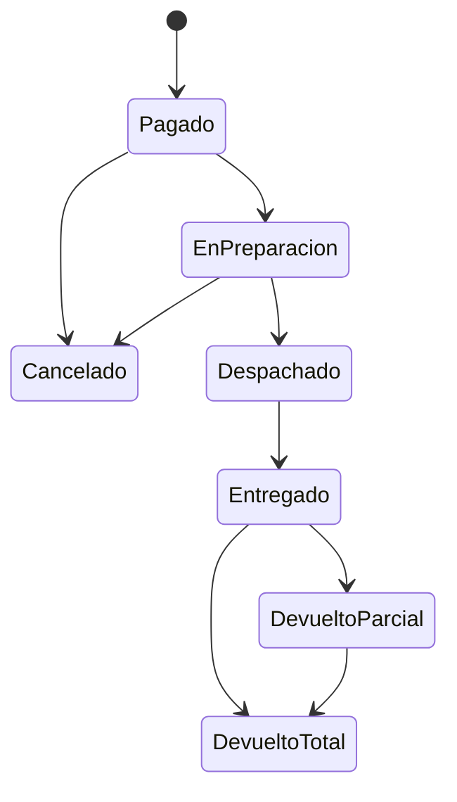

# ShopCart - Arquitectura y organizacion

Ultima actualizacion: **2-nov-2026**: reportes y dashboard (RF-08), semilla grande y README principal.

## 1. Mapa del repositorio
```
shopcart/
├── README.md                       instalacion, decisiones, diagrama ER, diagrama de estados, credenciales
├── docs/
│   ├── ARQUITECTURA.md             este documento
│   └── API.md                      referencia de endpoints
├── database/                       scripts numerados (run_all.sh [--reset]); ejecutar SIEMPRE en orden
│   ├── 001-003  BD, tablas/indices/constraints, catalogos y triggers
│   ├── 004-008  SPs: bitacora, auth, inventario, catalogo, sistema
│   ├── 009      ajustes de esquema (migracion: Anulado, MontoReembolsado, Pago >= 0)
│   ├── 010      reservas de existencia (15 min) y liberacion
│   ├── 011      cupones + FU_Cupones_CalculoDescuento
│   ├── 012      carrito (invitado/usuario) + direcciones
│   ├── 013      SP_Pedidos_CrearPedido (atomico e idempotente)
│   ├── 014      pedidos, cambio de estado, devoluciones
│   ├── 015      reportes: VW_Dashboard_VentasPedido, FU_Dashboard_Periodo, SP_Reportes_*
│   └── 016      semilla grande (2 000 clientes, ~9 000 variantes, 50 000 pedidos) con kardex coherente
├── backend/                        Express 5 + TypeScript strict + pnpm
│   ├── .env.example · package.json · pnpm-lock.yaml · pnpm-workspace.yaml · tsconfig*.json
│   ├── scripts/
│   │   ├── seed.ts                 usuarios, catalogo, direccion y cupones de demostracion
│   │   └── concurrencia.ts         prueba: ultima unidad, idempotencia y cupon de un solo uso
│   └── src/
│       ├── server.ts · app.ts      arranque, middlewares globales, montaje de rutas
│       ├── config/env.ts           variables de entorno validadas con zod
│       ├── db/                     pool.ts (conexion) · sp.ts (UNICA puerta a datos: SP tipados + reintento por 1205)
│       ├── errors/AppError.ts
│       ├── middleware/             auth.ts (JWT, roles, dueno del carrito) · errorHandler.ts
│       ├── routes/                 auth · catalogo (tienda + admin) · inventario · usuarios/bitacora ·
│       │                           carrito · checkout/direcciones · pedidos/cupones · reportes
│       ├── services/               auth · usuarios · catalogo · inventario · carrito · checkout · pedidos · cupones · direcciones · reportes
│       ├── repositories/           uno por modulo; cada metodo = un stored procedure
│       ├── validators/             common.ts · schemas.ts (zod)
│       ├── jobs/reservas.job.ts    libera reservas vencidas cada minuto
│       └── utils/                  tokens.ts · pagination.ts
└── frontend/                       (Fase 2) React 18 + TypeScript
```

## 2. Capas y responsabilidades
| Capa | Responsabilidad | Prohibido |
|---|---|---|
| Rutas | HTTP, validacion zod, rol requerido | logica de negocio |
| Servicios | orquestacion, hash de contrasenas/solicitudes, tokens, reglas por rol | SQL |
| Repositorios | un metodo = un SP con parametros tipados | SQL, ORM |
| Stored procedures | reglas criticas, transacciones, concurrencia, auditoria | SQL dinamico concatenado |
| Triggers/CHECK | ultima defensa (transiciones, inmutabilidad, existencias) | - |

## 3. Estado por requerimiento
| RF | Modulo | BD | API | Frontend |
|---|---|---|---|---|
| 01 | Auth y roles | hecho | hecho | - |
| 02 | Catalogo y variantes | hecho | hecho | - |
| 03 | Inventario / kardex | hecho | hecho | - |
| 04 | Carrito | hecho | **hecho** | - |
| 05 | Cupones | hecho | **hecho** | - |
| 06 | Checkout y pago | hecho | **hecho** | - |
| 07 | Pedidos y devoluciones | hecho | **hecho** | - |
| 08 | Dashboard y reportes | **hecho** | **hecho** | - |
| 09 | Bitacora | hecho | hecho | - |

## 4. Flujo de compra (extremo a extremo)
1. **Carrito** `/api/carrito`: invitado (header `X-Cart-Token`) o Cliente (JWT). Cada cambio libera sus reservas.
2. **Login** -> `POST /api/carrito/fusionar` pasa el carrito de invitado al usuario.
3. **Direccion** `/api/direcciones` (siempre del usuario autenticado).
4. **Iniciar pago** `POST /api/checkout/iniciar`: reserva todo el carrito 15 min o nada.
5. **Pagar** `POST /api/checkout/pagar` con `Idempotency-Key`: consume reservas, congela precios, kardex, pago, cierra carrito.
6. **Operador** `PATCH /api/pedidos/:id/estado`; **devoluciones** `POST /api/pedidos/:id/devoluciones`.
7. **Job** cada 60 s: `SP_Inventario_LiberarReservasVencidas`.

## 5. Ciclo de vida del pedido


## 6. Convenciones y reglas de diseno
- **Nombres:** `SP_Modulo_Proceso`, `VW_`, `FU_`, llaves `IDTabla`. API en JSON camelCase (la capa `db/sp.ts` convierte `IDProducto` -> `idProducto`).
- **Errores:** SQL `THROW` 50010/50011/50012/50013/50014 -> HTTP 404/409/422/403/401; 1205 (interbloqueo) se reintenta 3 veces y, si persiste, 503. Formato `{ error: { code, message, details? } }`.
- **Dinero:** `DECIMAL(18,2)`; precios con IVA 12 % incluido (`MontoIVA = Total*12/112`); los calculos ocurren en SQL.
- **Concurrencia:** orden de bloqueo `Carrito -> Variantes (IDVariante ascendente) -> Cupon`; reserva con `UPDATE` condicionado; `XACT_ABORT ON`.
- **Idempotencia:** `UNIQUE (IDUsuario, ClaveIdempotencia)` + hash SHA-256 del contenido.
- **Seguridad:** el dueno (carrito, direcciones, pedidos) sale del JWT; ningun endpoint acepta un id de carrito; un pedido ajeno responde 404. `authenticate` recarga al usuario en cada peticion.
- **Auditoria:** escrituras de catalogo, precios, existencias, cupones y estados de pedido -> `SP_Bitacora_Registrar`; bitacora y kardex inmutables por trigger.

## 7. Pendiente (orden sugerido)
1. Verificar en SQL Server: `run_all.sh --reset` completo (incluida la 016), `pnpm seed`, `pnpm concurrencia`, y medir los reportes con la semilla (objetivo < 1 s).
2. Fase 2 (vence 9-nov): frontend React + TypeScript: rutas protegidas por rol, tablas con paginacion/orden/filtros del servidor, graficas del dashboard (consumen `/api/reportes/*`), estados de carga/vacio/error, formularios con validacion, refresh de token transparente y diseno responsive.
3. Pulido para la defensa: repasar SPs criticos (reserva, checkout, cupones), preparar el guion de concurrencia y de decisiones (README seccion 5).
4. Extras opcionales (solo si todo lo obligatorio funciona): SSE en el dashboard, exportacion a Excel/PDF, cache de reportes.
